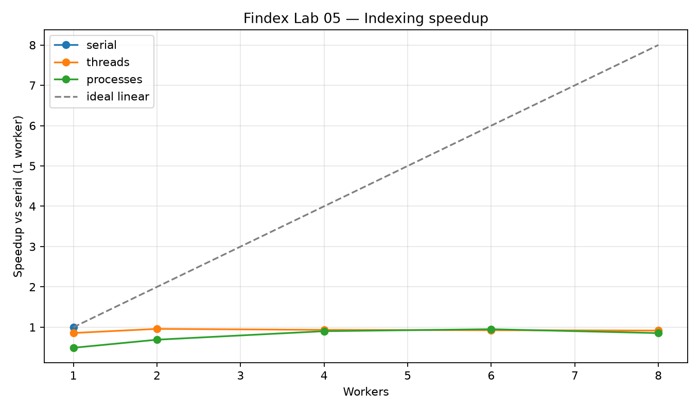

# Findex

Python search engine built progressively through Lab 06.

## Usage

```bash
uv sync --group dev
uv run python -m findex index data/ --out index.bin --positions
uv run python -m findex search index.bin "python"
uv run python -m findex stats index.bin
```

## Lab 01 — Iterators and the Corpus

The original `iter_documents` generator streams UTF-8 `.txt` files; unreadable files log a warning and are skipped. `tokenize` uses NFC normalization, case folding, and Unicode alphanumeric tokens, separating hyphens, apostrophes and underscores. The `stats` module compares eager and lazy processing.

| Version | Documents | Peak memory | Time |
|---|---:|---:|---:|
| Eager | 3 | 139,695 bytes | 0.00178 s |
| Lazy | 3 | 148,149 bytes | 0.00213 s |

These original measurements on the tiny corpus do not demonstrate a meaningful memory advantage.

## Lab 02 — Inverted Index and Memory

`Index` contains sorted `Posting(doc_id, tf, positions)` lists, per-document lengths and metadata. Boolean search supports implicit AND, OR, NOT, and both sorted-list merge and set engines. Pickle (`.bin`) and JSON (`.json`) persistence are supported. **Only unpickle files from trusted sources:** pickle deserialization can execute code.

### Posting representation experiment

Local measurement of the three-document corpus (Python 3.13.5, one run). These are memory allocations for constructing the compared representations, not full indexing peak RSS.

| Representation | Build peak | Pickle size | Load time |
|---|---:|---:|---:|
| Plain dataclass | 27,168 bytes | 4,353 bytes | 0.278 ms |
| Slotted dataclass | 18,040 bytes | 3,750 bytes | 0.231 ms |
| `array('I')` pairs | 16,800 bytes | 4,629 bytes | 0.142 ms |

Plain dataclass objects retain instance dictionaries; slotted dataclasses omit them, and arrays store compact integers without per-posting objects. On this very small sample, pickle's container and serialization overhead makes the array file larger, despite its lower construction memory. The experiment source is `benchmarks/memory.py`.

### Merge-vs-set and serialization measurements

Measured on the provided three-document corpus during the complete-project audit. Times are median of seven calls, in milliseconds; these tiny-call timings are sensitive to noise.

| Query term | Merge (ms) | Set (ms) |
|---|---:|---:|
| python | 0.01317 | 0.00375 |
| programming | 0.00353 | 0.00401 |
| java | 0.00425 | 0.00313 |
| gosling | 0.00435 | 0.00366 |

| Format | File bytes | Save (ms) | Load (ms) |
|---|---:|---:|---:|
| json | 5494 | 0.3950 | 0.1825 |
| bin | 6039 | 0.5823 | 0.2593 |

Positions increased binary index size from 5497 to 6039 bytes on this sample.

## Lab 03 — Object Model, Query Language and Ranking

`Index` implements the mapping protocol and exposes `num_docs`, `avg_doc_length`, `doc_length`, and `df`. Query nodes (`Term`, `Phrase`, `And`, `Or`, `Not`) form a dataclass AST with `&`, `|`, `~`, and `.evaluate(index)`. The parser supports precedence, quoted phrases, NOT, and parentheses. `TfIdf` and `BM25(k1=1.5, b=0.75)` implement a swappable scorer interface. Top-k results include document titles and highlighted context snippets. Query parsing uses an LRU cache of 256 expressions. Ranking saturation and length normalization are tested.

### Hand-labeled precision@5 (three-document corpus)

The labels were written against the actual sample documents. Each query has one relevant document, so the maximum possible precision@5 is 0.20; this is not a realistic search-quality benchmark.

| Query | Relevant title | TF-IDF P@5 | BM25 P@5 |
|---|---|---:|---:|
| python | document | 0.20 | 0.20 |
| garbage collection | document | 0.20 | 0.20 |
| dynamic typing | document | 0.20 | 0.20 |
| java | document2 | 0.20 | 0.20 |
| gosling | document2 | 0.20 | 0.20 |
| oracle | document2 | 0.20 | 0.20 |
| javascript | document3 | 0.20 | 0.20 |
| typescript | document3 | 0.20 | 0.20 |
| github | document3 | 0.20 | 0.20 |
| web | document3 | 0.20 | 0.20 |

Ranking sanity checks (also covered by automated tests): BM25 term-frequency gains diminish under repetition; length normalization favors a shorter document at equal term frequency; uncommon terms have greater inverse-document-frequency influence. For this very small corpus, ties and query-specific lengths can affect observed order.

## Lab 04 — Typing, Testing, Packaging and CLI

The package defines a `findex` console entry point with `index`, `search`, and `stats` commands (with `crawl` added in Lab 06). The command-line interface supports the required search and index options. `pyproject.toml` configures strict pyright, Ruff, pytest, and optional development dependencies. `.github/workflows/ci.yml` includes linting, format, type checks, and coverage for pushes and pull requests.

Ruff formatting and strict Pyright are configured for this project. Build a wheel with `uv build`. The CLI can also run with `python -m findex`, which is useful when Windows Application Control blocks the `findex.exe` launcher.

## Lab 05 — Concurrency and the GIL

The indexer supports three execution modes: `serial`, `threads` (`ThreadPoolExecutor`), and `processes` (`ProcessPoolExecutor`). Workers receive file paths, build partial indexes, and the parent merges the postings. Document IDs are normalized consistently across executors, including when an invalid UTF-8 document is skipped. The CLI exposes `--workers` and `--executor`. Tests passed locally, and postings, document lengths, and metadata matched across the three executors on the sample corpus.

### Benchmark methodology

The benchmark used a synthetic corpus of **5,000 UTF-8 documents**, created by repeating the three valid sample documents. The machine reported **6 logical CPUs** (`os.cpu_count()`); the CPU model was not recorded. Each configuration was warmed up once and then measured **three times**. The table reports the **median**. Workers tested: 1, 2, 4, 6 (all available logical CPUs), and 8; serial uses one worker. Speedup is the serial median wall time divided by each configuration's median wall time.

CPU time and RSS are measurements of **the parent process only**, not total worker CPU usage or combined worker memory. The RSS column therefore must not be interpreted as peak RSS across the entire process tree.

| Executor | Workers | Wall (s, median) | Parent CPU (s) | Parent RSS (MiB) | Merge (s) | Speedup |
|---|---:|---:|---:|---:|---:|---:|
| Serial | 1 | 1.479 | 1.438 | 82.25 | 0.214 | 1.00× |
| Threads | 1 | 1.726 | 1.531 | 82.47 | 0.272 | 0.86× |
| Threads | 2 | 1.543 | 1.875 | 82.36 | 0.350 | 0.96× |
| Threads | 4 | 1.583 | 1.828 | 82.68 | 0.353 | 0.93× |
| Threads | 6 | 1.597 | 2.000 | 82.50 | 0.343 | 0.93× |
| Threads | 8 | 1.613 | 2.047 | 83.68 | 0.348 | 0.92× |
| Processes | 1 | 3.018 | 0.828 | 115.47 | 0.192 | 0.49× |
| Processes | 2 | 2.143 | 0.875 | 92.15 | 0.216 | 0.69× |
| Processes | 4 | 1.641 | 0.953 | 89.52 | 0.290 | 0.90× |
| Processes | 6 | 1.555 | 0.953 | 89.50 | 0.221 | 0.95× |
| Processes | 8 | 1.732 | 1.016 | 90.09 | 0.311 | 0.85× |



Benchmark data: `docs/lab05-benchmark.csv` and `docs/lab05-benchmark.json`. Benchmark implementation: `benchmarks/concurrency.py`.

### Interpretation: GIL, processes, and Amdahl's law

CPython's Global Interpreter Lock (GIL) permits only one thread at a time to execute Python bytecode within a conventional interpreter. As a result, threads often do not accelerate CPU-bound tokenization and dictionary updates; thread scheduling and coordination can add overhead. Threads remain useful for **I/O-bound** workloads because blocking operations can release the GIL, allowing other threads to make progress while one waits.

Processes have separate interpreters and GILs, so they can execute CPU-bound Python code on different cores. This comes at a price: creating processes, pickling task arguments and results, transferring partial indexes, and allocating separate process memory. Sending file paths rather than fully loaded documents reduces transfer overhead. Here, six processes were the fastest process configuration (1.555 s), but still did not beat serial indexing (1.479 s). Two threads were the fastest thread configuration (1.543 s); no parallel configuration achieved a speedup above 1.0×. These observations apply to the synthetic corpus and this machine, not all workloads.

The merge phase is performed in the parent and is not parallelized. This sequential fraction bounds maximum speedup under **Amdahl's law**: with fraction `s` of work inherently sequential and `N` workers, ideal speedup is limited to `1 / (s + (1 - s) / N)`. The measured merge durations (approximately 0.19–0.35 s across configurations) illustrate a nonzero serial cost, although they should not be used alone to estimate the total sequential fraction.

### Free-threaded Python 3.13 — M4

The experiment compared **CPython 3.13 (GIL enabled)** with **CPython 3.13.18 free-threaded (GIL disabled)** on Windows. `sys._is_gil_enabled()` returned `True` for the traditional build and `False` for the free-threaded build. Both used the same `build_parallel` function with `ThreadPoolExecutor`, **6 workers**, and the same synthetic corpus of **5,000 documents** (135 unique terms). Each configuration was measured three times with `time.perf_counter()`, using the median as the summary statistic.

| Python build | GIL enabled | Run 1 (s) | Run 2 (s) | Run 3 (s) | Median (s) |
|---|---|---:|---:|---:|---:|
| CPython 3.13, traditional | `True` | 1.405 | 1.573 | 1.611 | **1.573** |
| CPython 3.13.18, free-threaded | `False` | 1.161 | 1.225 | 1.276 | **1.225** |

The free-threaded build completed this particular workload **0.348 s faster (22.1% less elapsed time)**, equivalent to **1.28× speedup** over the traditional build. Both runs reported 5,000 indexed documents and 135 terms. This is a small, synthetic, three-run comparison, not a general claim of free-threaded scaling or proof of race-condition freedom. The executors' output equivalence was tested separately on the sample corpus.

Reproduce these results with `benchmarks/nogil.py`, using the free-threaded and traditional Python 3.13 interpreters respectively. The benchmark imports the project directly with `PYTHONPATH=src`, avoiding optional CLI dependencies that may require compiled extensions under Python 3.13t.

## Lab 06 — Asyncio Crawler

The crawler in `src/findex/crawler/` uses `httpx.AsyncClient`, bounded retries with exponential backoff and jitter, `Retry-After` handling for HTTP 429, and `asyncio.timeout`. A cached `robots.txt` policy is checked before fetching pages. The `Queue` frontier and `TaskGroup` workers operate with global and per-host concurrency limits, a minimum per-host delay, URL canonicalization, a seen-URL set, and a domain allowlist. `crawl()` yields pages incrementally as an async generator; CPU-bound indexing is performed later, outside the event loop. `tests/test_crawler.py` uses `httpx.MockTransport` for isolated HTTP tests.

### Crawl and index

Only crawl websites where you have permission. The seed domain is used as the default allowlist; the crawler obeys `robots.txt`, respects the page limit, and requires a truthful `User-Agent` with **your own contact URL**. For example, replace the example URLs below with a domain you control and your real contact page:

```bash
uv run python -m findex crawl https://your-site.example/ --max-pages 500 --concurrency 10 --per-host 2 --user-agent "FindexCrawler/0.6 (+https://your-site.example/contact)" --out data/crawl.jsonl
uv run python -m findex index data/ --out crawled-index.bin
uv run python -m findex search crawled-index.bin "python"
```

The crawl command writes each page to a JSONL record (`url`, `title`, `text`, `fetched_at`) as it arrives. `iter_documents` reads both the original `.txt` files and the crawler `.jsonl` output; `findex index` indexes them together. The live display reports pages fetched, pages/s, requests in flight, errors and frontier size. The per-URL crawl log is `crawl.log` (excluded from Git). The `--user-agent` setting identifies the crawler; do not use a contact URL that does not belong to you.

### Concurrency benchmark

`benchmarks/crawler.py` defines a 200-page local `httpx.MockTransport` fixture to compare concurrency levels of 1, 5 and 20 without external requests. It includes a simulated HTTP 429 response with `Retry-After` and writes benchmark results to `docs/lab06-benchmark.csv` when run. The per-host limit matches global concurrency and the delay is zero for this controlled fixture.

```bash
uv run python benchmarks/crawler.py --pages 200
```

Async request overlap can improve throughput for I/O-bound tasks. A per-host concurrency limit and delay help avoid overloading a target server. The crawler writes JSONL before synchronous indexing so that tokenization does not block the event loop.

## Lab 07 — FastAPI Web Search

The FastAPI application is in `src/findex/web/`. The `lifespan` context manager loads the existing index once on startup; dependency injection supplies it to routes. `pydantic-settings` reads `INDEX_PATH`, `LOG_LEVEL`, and `PORT` from the environment (or `.env`). Search scoring is blocking CPU work, so the primary `/search` handler is a synchronous `def` route and is offloaded by FastAPI's thread pool.

### API and web interface

| Route | Behavior |
|---|---|
| `GET /search?q=python&k=10&scorer=bm25&page=1` | Validated, paginated JSON search response with scores and snippets |
| `GET /docs/{doc_id}` | Full document as JSON; `404` if the ID is unknown |
| `GET /stats` | Documents, vocabulary, total tokens, and uptime |
| `GET /health` | `200` if the index is available; otherwise `503` |
| `GET /docs` | Generated interactive OpenAPI documentation |
| `GET /` | Jinja2 search page with highlighted snippets and pagination |
| `GET /doc/{doc_id}` | Full HTML document view |

Search parameters enforce `q` length 1–200, `k` between 1 and 100, `scorer` of `bm25` or `tfidf`, and `page >= 1`; invalid values produce a JSON `422` response. Errors carry a JSON `detail`; unexpected errors are logged with a request ID. Static styling is served from `src/findex/web/static/`.

To run locally, first create an index, then launch the service:

```bash
uv sync --group dev
uv run python -m findex index data/ --out index.bin --positions
uv run python -m findex serve --port 8000 --workers 1
```

Open `http://localhost:8000/`, `http://localhost:8000/docs`, and `http://localhost:8000/health`. Set `INDEX_PATH` to point at a different index; `LOG_LEVEL` and `PORT` are also configurable from the environment. An invalid or absent index produces an unavailable health check rather than silently reporting a healthy search service.

### M2 — Test setup and concurrency comparison

`tests/test_web.py` contains `TestClient` route tests with `dependency_overrides` for a two-document in-memory index, covering successful API calls, parameter validation (`422`), missing documents (`404`), the UI, and unavailable index (`503`). `benchmarks/web.py` prepares a 20-concurrent-request comparison of the synchronous search route (`/search`) and an async route using `asyncio.to_thread` (`/search-async`).

### M4 — Container, deployment, and load testing

The multi-stage `Dockerfile` uses `uv`, a slim Python runtime, a non-root account, a built-in sample index, and `/health` as its container health check. Build and run after resolving the project dependencies:

```bash
docker build -t findex .
docker run --rm -p 8000:8000 -e INDEX_PATH=/app/index.bin findex
```

The application is configured for deployment on a Docker-compatible hosting platform using environment variables and `/health`. **No deployed public URL is available yet**, and Docker has not been built or run for this delivery.

Both the normal synchronous endpoint and the async endpoint with `asyncio.to_thread` offload CPU-bound ranking to threads instead of doing it directly in the event loop. On conventional CPython, the GIL can limit CPU-bound thread scaling; multiple Uvicorn worker processes use separate interpreters and can use more cores, at the cost of more memory and startup overhead. Network latency and scheduling also affect tail latency.
